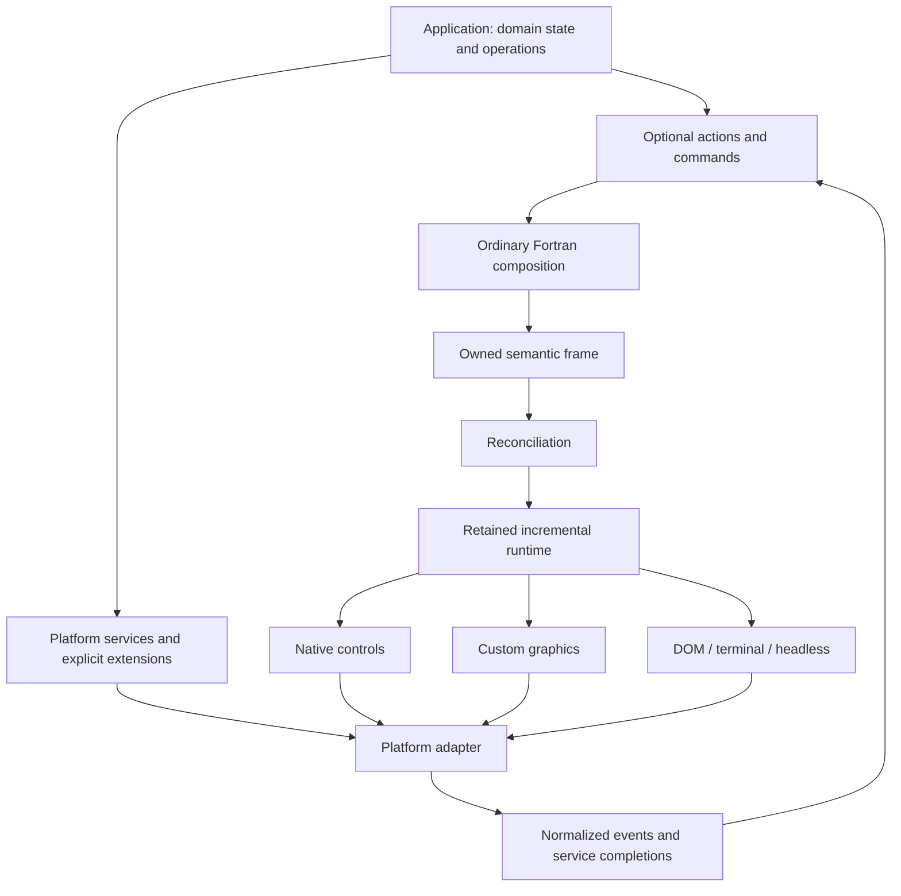

# FortUI architecture

FortUI is a Fortran-native semantic UI framework with declarative/immediate
composition over a retained incremental runtime, capable of realizing the same
application intent through native controls, custom graphics, the web DOM,
terminals, or headless automation while preserving platform-specific capabilities.

This document freezes the principle layer. Renderer choices, layout algorithms,
cache structures, reconciliation implementation, and exact future API spelling
remain discoverable through real applications. The implementation is a prototype;
[PLAN.md](PLAN.md) distinguishes completed work from proposed capabilities.

## Architecture map



User code describes intent; the runtime retains reality. Semantic controls express
identity, role, value, state, relationships, constraints, and actions. Backends
choose appropriate presentation. Platform services have independent request
lifecycles rather than pretending that files, sharing, or notifications are widgets.

Read the detailed contracts when implementing their subsystem:

- [Transactions and commands](docs/TRANSACTIONS.md): scheduling, activation,
  inline changes, dispatch, asynchronous completion, and failures.
- [Semantic and runtime model](docs/SEMANTIC_MODEL.md): identity, ownership,
  editing, layout, accessibility, canvas metadata, inspection, and invalidation.
- [Platform boundary](docs/PLATFORM_BOUNDARY.md): native/custom realization,
  text infrastructure, DOM, services, capabilities, ABI, and backend evidence.
- [TPX experiment](docs/TPX_EXPERIMENT.md): independent tracks, common behavior,
  acceptance slices, and comparison rules.

## Fortran authoring

The primary DSL is ordinary Fortran with conditionals, loops, functions, and types.
The prototype already permits this style:

```fortran
call ui_init(headless_backend_t(), 1200, 800, "Document")   ! or ui_init("auto", ...)
do while (.not. ui_should_close())
    call ui_frame_begin()
    if (ui_key_pressed(KEY_ESCAPE)) call ui_request_quit()
    call split_begin("main", first=260.0, gap=8.0)
    call column_begin(gap=6.0)
    call text("Document", style=UI_TITLE)                 ! static text needs no id
    call row_begin(gap=8.0)
    if (button("open", "Open")) call open_document()
    if (button("save", "Save", enabled=dirty)) call save_document()
    call row_end()
    changed = tabs("view", [character(8) :: "Layers", "Style"], tab)
    if (tab == 1) then
        do k = 1, nlayers                                   ! identity "main/layer#k"
            if (checkbox("layer", visible(k), layer_name(k), key=k)) call redraw()
        end do
    else
        changed = slider("width", 1, 10, line_width)        ! integer or real
        call text("Width " // ui_str(line_width), style=UI_CAPTION)
    end if
    call column_end()
    call split_next()
    call canvas_begin("drawing", view, events)
    call canvas_vertices("pos", generation, xy)             ! one shared vertex layer
    call canvas_lines("edges", "pos", segments, colours)
    call canvas_points("nodes", "pos", colours, size=4.0)
    call canvas_end(view)
    call split_end()                                        ! balance checked at present
    call ui_present()
end do
```

Identity is the id scoped by enclosing containers that carry one plus an
integer `key=` inside loops; duplicates in one frame are reported and skipped.
Widths are logical units or `UI_FILL`; `style=` tokens (`UI_BODY`, `UI_CAPTION`,
`UI_HEADING`, `UI_TITLE`) and an absolute `size=` choose text presentation, and
`ellipsis=` lets the backend shorten text that does not fit. Escape is an
ordinary key; quitting is the application's decision. Backends are values that
the application injects, so the core links no platform it does not use.

The desired scheduling contract executes composition once per scheduled semantic
transaction. Layout, painting, reconciliation, and accessibility queries never
execute that user routine. Transactions are serialized and composition is
nonreentrant. A physical gesture can generate several transactions.

The prototype's frame loop does not yet enforce the complete scheduling contract.
An inline handler can change state after earlier controls were emitted. A widget
that consumed input (activation, toggle, changed value, canvas click, handled
shortcut) therefore schedules exactly one follow-up frame without a new activation,
so the coherent post-action description appears without application requests.
Never replay the same transaction or silently assume arbitrary Fortran composition
is pure.

## State has explicit owners

| State | Authority | Examples |
|---|---|---|
| Domain | Application | Document geometry, committed properties, history, dirty flag |
| UI-local | FortUI runtime | Focus, hover, capture, scroll, draft text, caret, IME session |
| Platform | Adapter/host | Native handles, lifecycle, device resources, service requests |

Application values may be mirrored for presentation; mirrors never become competing
authorities. Editing drafts can temporarily differ from committed domain values.
Commit/cancel and external-update policies make that difference explicit.

Frames and queued events own their payloads. Runtime and backend code must not keep
borrowed pointers to caller scalars or temporary strings across composition. Use
owned typed payloads, stable keys, and generation-checked handles for callbacks.

## Commands are independent of controls

Save, undo, zoom, and delete are operations, irrespective of whether a menu,
toolbar, shortcut, touch control, command palette, or accessibility action invokes
them. An optional command registry provides metadata and one execution owner.
The application validates current domain eligibility when dispatching an operation.

A possible future API is shown below; these calls are design notation, not shipped
symbols or a final Fortran signature:

```fortran
! Application initialization selects one dispatcher/handler mechanism.
call action_register(ACTION_SAVE, handler=save_action)
! Composition describes availability and presentation.
call action_define(ACTION_SAVE, label="Save", enabled=document%dirty)
call action_button("save", ACTION_SAVE)
call menu_action("file/save", ACTION_SAVE)
```

Action-bound controls route the intent to the selected command owner. They do not
return a second signal instructing the application to execute it again. The simple
inline `if (button(...)) call ...` form remains available without a command registry.
A semantic toggle likewise needs an owned value and an explicit update intent,
independent of whether its realization is a switch, checkbox, or terminal marker.

## Meaning travels; realization adapts

Choose native/custom/hybrid realization per backend and control. Native menus,
file pickers, text services, ordinary editors, and accessibility can coexist with
custom canvases, plots, and Bezier manipulation. No backend must support every
strategy. Realization policy is replaceable behind tested semantic contracts.

Browser ordinary controls use semantic DOM/HTML. Heavy drawing uses Canvas or an
appropriate GPU renderer; Fortran/WebAssembly executes the application. Navigation,
URLs, history, file access, and user-activation requirements are explicit platform
integrations. A DOM backend does not automatically make drawn text searchable or
provide application navigation.

TUI realizes meaning in terminal-appropriate structures. A drawing canvas can
become an object list and coordinate editor with optional previews. It requires
application-supplied object/action metadata; it cannot infer a document from pixels.
Headless realizes semantics and events for deterministic automation.

## Layout, text, accessibility, and performance

Graphical coordinates are device-independent logical units. Intrinsic sizing,
min/max, grow/shrink, alignment, spacing, padding, overlays, scrolling, split views,
and useful grids form a bounded layout vocabulary. Multipass measurement is allowed;
CSS is not the portable layout specification. Native/DOM hosts may measure and lay
out controls themselves and return realized geometry for input and inspection.

Text editors use native-integrated editing services where appropriate. UTF-8,
selection, drafts, IME composition, validation, clipboard, and commit conflicts
are infrastructure. Do not reset an IME session on every semantic update.

Accessibility roles, labels, states, ranges, actions, relationships, and focus
order belong to semantic nodes from the start. Host bridges and actual assistive
technology behavior still need platform tests.

Retain expensive layout, shaped text, tessellation, textures, GPU buffers, native
handles, accessibility nodes, and virtualized ranges. Invalidate affected work
selectively. Zero composition/layout/redraw at idle is a measured goal; animations
and caret blink may wake the runtime without executing application composition.
Do not claim incremental performance merely because reconciliation exists.

## Ecosystem boundaries

FortUI owns UI semantics, control definitions, layout, accessibility, reconciliation,
commands, and capabilities. FortGen may supply generic source-emission, serialization,
buffers, formatting, provenance, and binding generation only after genuine reuse.
FortGen must not know what a button is. The embedded DSL matches the ecosystem
principle used by FortSym and FortFEM.

Optional external declarative formats may later lower into the same semantic IR.
Introduce one only when an application demonstrates a concrete need. No second
runtime, hidden binding authority, or mandatory markup language is required.

Application and most framework semantics live in Fortran. Small C, Objective-C,
Java/Kotlin/JNI, or JavaScript shims are acceptable for platform lifecycle and ABI
integration. Judge their responsibilities and dependencies, not ideological purity.

## Prototype and target status

| Area | Implemented base | Design target |
|---|---|---|
| Composition | Explicit begin/present frame loop | Event-driven, single composition per transaction |
| Semantics | Text/button/slider/checkbox/tabs/text field/scroll text/canvas nodes | Roles, commands, owned variable-length data, relationships |
| Identity/input | Container-scoped ids and loop keys with duplicate reports; previous-frame routing | Generations, capture/focus/edit lifecycle |
| Layout | Logical rows/columns, fill widths, two/three-pane splits | Intrinsic/adaptive layout and virtualization |
| Backends | Headless, termbox2 TUI, optional raylib | Native/hybrid, DOM, mobile and additional renderers |
| Text/accessibility | Basic labels | Editing/IME/shaping and verified host accessibility |
| Performance | Retained frame/storage foundation | Dependency invalidation and measured incremental work |

This table describes the base revision; completed milestones and executed evidence
belong in [PLAN.md](PLAN.md). The target matrix is Windows/macOS/Linux, iOS/Android,
Web, terminal, and headless. Compiler support alone does not establish backend support.

## Acceptance and historical rationale

TPX/FortUI is an early architectural acceptance test within a controlled comparison
against preserved Pascal/LCL and idiomatic C#/Avalonia. The three applications share
behavioral specifications and fixtures, with independent implementation code.
Do not put this experiment or FortUI redesign into the original TPX repository.

The design combines direct manipulation, domain/presentation separation, stable
identity, commands and RAD inspectability, HTML semantics, state-driven descriptions,
retained reconciliation, and immediate host-language ergonomics. These traditions
coexist; there is no inevitable historical winner. Persistent objects and callbacks
remain appropriate inside runtime and platform implementations.

Freeze those principles; change an abstraction when a real application demonstrates
that it fails. Headless behavioral evidence establishes semantic correctness;
backend tests establish actual rendering, text, accessibility, and platform quality.
